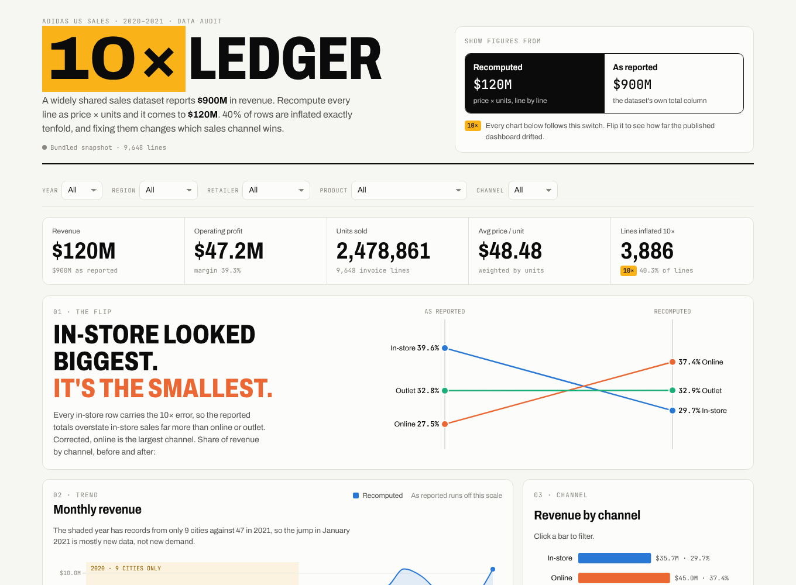
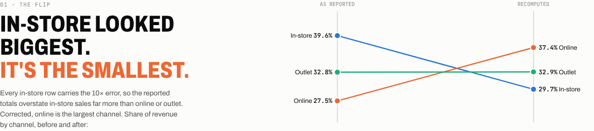

# The 10× Ledger: auditing the Adidas US sales dataset

**A widely shared sales dataset reports $900M in revenue. Recompute every line as price × units and it comes to $120M.**
40% of the rows are inflated exactly tenfold, and fixing them reverses which sales channel looks strongest.

**[Open the live dashboard →](https://qaisbello.github.io/data-analytics/adidas-sales/)** · reads `data/cleaned/` from this repo on every load



## The finding

| | As reported | Recomputed (price × units) |
|---|---:|---:|
| Revenue | $899.9M | **$120.2M** |
| Operating profit | $332.1M | **$47.2M** |
| Largest channel | In-store (39.6%) | **Online (37.4%)** |
| Smallest channel | Online (27.5%) | **In-store (29.7%)** |



Every one of the 1,740 in-store lines carries the 10× error, so the published totals overstate in-store sales far more than online or outlet sales. Any dashboard built on the raw `Total Sales` column, including my own first version in Excel ([`excel/`](excel/)), ranks the channels the wrong way round.

## What I did

1. **Profiled the data.** I checked every column for blanks, types and ranges, and confirmed which fields should agree with each other.
2. **Found the 10× rows.** `Total Sales ÷ (Price × Units)` takes exactly two values across the whole file: 1 and 10. Operating profit follows the inflated column, so it is 10× too.
3. **Looked for a cause instead of patching blindly.** The inflated lines also sell about 3× more units (median 425 vs 124). 1,670 of them pair up with a normal line on the same day, city, product and channel. That pattern suggests two sources merged at different scales, not a one-off typo. Both figures are kept in the data so the choice stays visible and reversible.
4. **Checked the other claims.** The 2020-vs-2021 "growth" compares 9 cities with 47. Only 2 city-retailer pairs appear in both years, too few for a fair like-for-like comparison, so the dashboard labels growth as unreliable instead of headlining it. Retailer IDs are shared across up to six retailers, so I dropped them. Charleston and Portland exist in two states each, so cities are keyed by city + state.
5. **Built an interactive audit dashboard.** One switch moves every figure between the reported and recomputed numbers. Year, region, retailer, product and channel filters cross-filter everything, and the state map, retailer bars and product × region heatmap are all clickable.

Every check is logged with a row count in [`data/cleaned/data_quality_log.csv`](data/cleaned/data_quality_log.csv) and shown at the bottom of the dashboard.

## Skills shown

Data profiling and validation · root-cause analysis of data errors · Python (pandas) · reproducible cleaning pipeline · interactive dashboards (D3.js) · data storytelling · documenting assumptions and limits

## Repo layout

```
data/raw/adidas_us_sales.xlsx        original dataset (unchanged)
data/cleaned/sales_clean.csv         cleaned lines with reported AND recomputed values + flags
data/cleaned/data_quality_log.csv    every check, rows affected, finding, action
data/cleaned/audit_summary.json      headline numbers
src/clean.py                         audit + cleaning (run this)
src/dashboard_template.html          dashboard source
src/build_dashboard.py               builds dashboard/index.html
dashboard/index.html                 standalone dashboard
docs/data-dictionary.md              every column explained
excel/                               the original Excel dashboard (v1), kept for comparison
```

## Power BI version

The same analysis as a ready-made Power BI report, in [`powerbi/`](powerbi/): the audit page (reported vs recomputed, the channel flip, every data quality check) and a sales page where one slicer switches every figure between reported and recomputed sales. Totals and channel shares are checked against `audit_summary.json`. Open `powerbi/Adidas_Audit.pbip` in Power BI Desktop and click Refresh; it reads the cleaned data from this repo.

## Run it

```bash
pip install -r requirements.txt
python src/clean.py              # rebuilds data/cleaned/
python src/build_dashboard.py    # rebuilds dashboard/index.html
```

Open `dashboard/index.html` through any local web server (for example `python -m http.server`), or use the live link above.

## Limits

- This is a public Kaggle dataset whose origin isn't verified. Treat it as illustrative, not as Adidas's real figures.
- Recomputing from price × units assumes those two columns are right and the total is wrong. The data can't prove which side is wrong, which is why both are kept.
- The 2020 data is too thin for year-on-year conclusions.

---
Cleaning, audit and dashboard by **Qais Adeniji-Bello** · [qaisbello.github.io](https://qaisbello.github.io) · [LinkedIn](https://www.linkedin.com/in/qais-adeniji-bello/)
